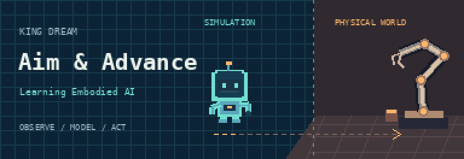

# King Dream

我正在学习**具身智能与机器人**，关注机器人如何感知环境、做出决策并执行动作，以及如何把仿真中的策略迁移到真实系统。

**[具身智能周刊](https://kingdream-cn.github.io/embodied-ai-weekly/)** · 追踪具身智能论文、开源项目和行业进展。[源码](https://github.com/kingdream-cn/embodied-ai-weekly)

**[技术博客](https://kingdream-cn.github.io/)** · 记录技术学习与实践。

## 研究兴趣

- **机器人感知与控制** · 从传感器观测到闭环动作
- **机器人学习** · 模仿学习、强化学习与机器人操作
- **仿真到真实（Sim-to-Real）** · 仿真验证与策略迁移

## 项目

- **[weekly-craft](https://github.com/kingdream-cn/weekly-craft)** · 用 Python CLI 和 Agent Skill 把候选素材整理成可审核的 Markdown 周刊，并准备正文预览与发布文件。
